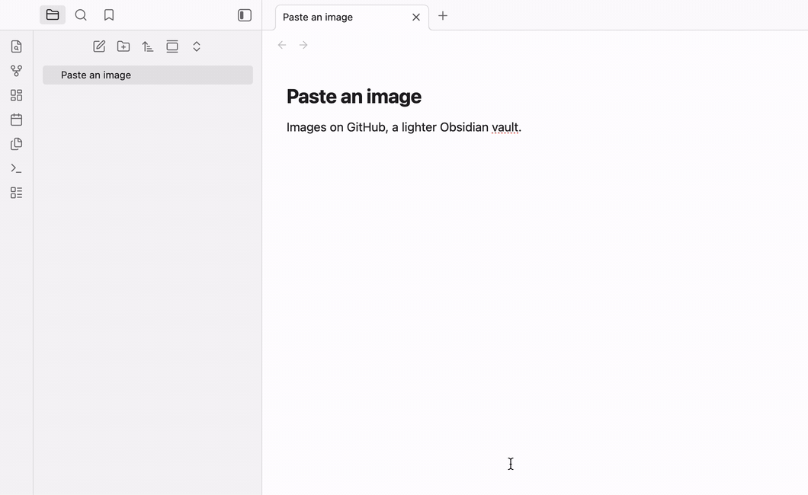
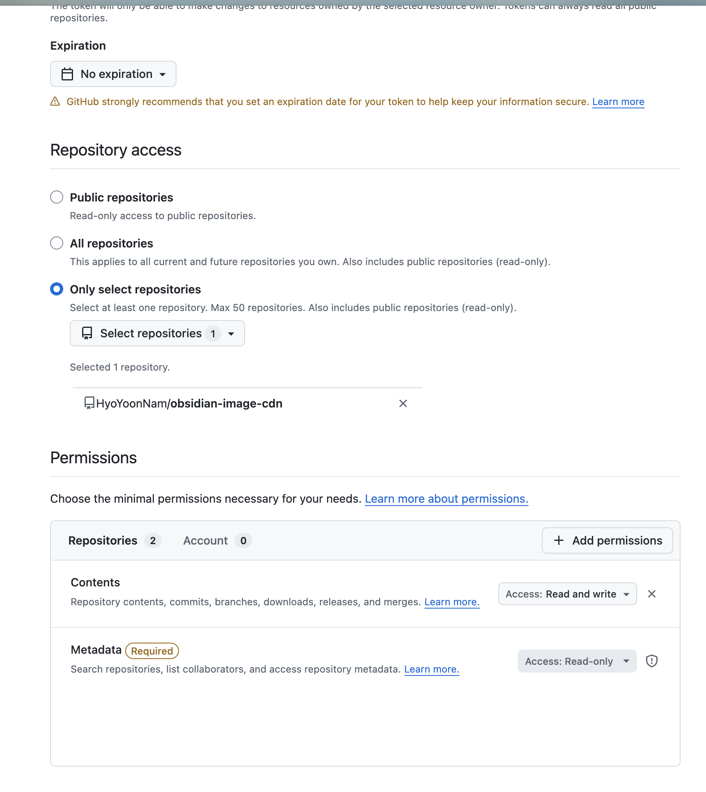

# Image Paste on GitHub

Upload pasted or dropped images to your public GitHub repository and embed their URLs in Obsidian.



*Recorded in Obsidian.* [View the final frame](docs/images/obsidian-paste-demo.png).

> **Public uploads:** The repository must be public, and every uploaded image is publicly accessible. Do not upload sensitive screenshots.
>
> **Token storage:** This plugin stores your token unencrypted in `data.json`. Do not sync, commit, or share that file.

Install and enable Image Paste on GitHub from [Obsidian's community plugins](https://community.obsidian.md/plugins/image-paste-on-github).

## Quick start

1. Create or choose a **public image repository**, then enter **Owner** and **Repository** in Settings → Image Paste on GitHub.
2. Open **Create a token → Open GitHub**. On GitHub, select only that repository, grant **Contents: read and write**, set an **expiration date**, and paste the token into **GitHub token**.
3. Check **Branch** (default `main`), use **Test connection** to check repository access, then paste or drop an image into a Markdown note.

<details>
<summary>Repository and token setup</summary>

**Create repository** tries to create a public repository using your token. With no token or insufficient permission, it opens GitHub's new-repository page. If you create the repository on GitHub, enter its owner and name in the plugin settings.

**Create a token** opens GitHub's fine-grained token form. Choose the repository and permissions there. **Test connection** checks repository access, visibility, and the reported push permission. It does not upload a test file or check the selected branch.

**Branch** defaults to `main`; select a branch that exists in your repository. **Upload path** defaults to `assets`. Enter paths and branch names as-is, without URL encoding. Spaces, Unicode, `#`, `?`, parentheses, and literal `%` are encoded in URLs. Folder separators and valid branch names such as `feature/images` are supported.

The screenshot below is a reference for repository selection and **Contents: read and write**; Metadata remains read-only. Set an expiration date for your own token, even though the screenshot shows “No expiration.”



</details>

<details>
<summary>Formats, failures, and cancellation</summary>

Successful uploads insert a `raw.githubusercontent.com` image link without creating a local attachment. While uploading, a temporary placeholder marks the insertion point.


*Workflow illustration.* [View the static diagram](docs/images/paste-workflow.svg).

Files with MIME types `image/png`, `image/jpeg`, `image/gif`, `image/webp`, `image/svg+xml`, `image/bmp`, and `image/avif` are uploaded without conversion. These types are selected from the file's MIME string, without inspecting its bytes.

**HEIC and HEIF** (`image/heic`, `image/heif`) are converted locally to JPEG with a bundled decoder. An empty MIME type is accepted only when the filename ends in `.heic` or `.heif`, ignoring case. Other unknown MIME types are not inferred from filenames. Conversion processes one primary image (or the first image) at JPEG quality 0.9, without preserving original metadata or additional images. HEIC conversions run one at a time and use no external conversion service.

With **Save locally on failure** enabled, an upload failure saves the image to your vault, including the converted JPEG for HEIC inputs. A conversion failure preserves the original HEIC or HEIF as a normal file link and shows a notice. With the setting off, conversion failure saves and uploads nothing. Export the original as JPEG and try again.

Missing configuration, mixed attachments such as an image and a PDF, unsupported files, Canvas, and editors outside an open Markdown note view use Obsidian's default handling. If one attachment is unsupported, the whole paste or drop uses the default handling.

Pending uploads stay tied to the original note when you switch tabs or rename it. Removing the placeholder cancels insertion and prevents uploads that have not started. A conversion already running may finish; an image already uploaded to GitHub is not deleted.

</details>

<details>
<summary>Security</summary>

Use a fine-grained token limited to one dedicated image repository, with **Contents: read and write** and an expiration date. A leaked token can modify other content in that selected repository, not just images. Revoke and replace an exposed token.

The plugin sends the token to GitHub in the `Authorization` header and does not put it in note links or URL query strings. Its stored copy remains plaintext in the vault's plugin `data.json`, so keep that file out of sync, commits, and shared backups.

</details>

<details>
<summary>Development and license</summary>

Development requires Node.js 20 or later.

The optional GitHub App authentication relay has no runtime dependencies. See [relay setup and deployment](relay/README.md) and the [authentication design](docs/auth-design.md). Its client secret stays on the server, and images continue to upload directly to GitHub. A real GitHub App and HTTPS deployment must be configured separately.

```bash
npm ci
npm run dev           # watch build
npm run build         # type-check and production bundle
npm test              # mocked plugin and API regression tests
npm run test:relay    # local HTTP relay with a mocked GitHub upstream
npm run test:browser  # real HEIC conversion using the production bundle
```

The browser test uses installed Google Chrome by default. Set `CHROME_EXECUTABLE_PATH` to another Chrome or Chromium executable if needed. It uses the [synthetic fixture](tests/fixtures/SOURCE.txt), blocks external requests, and stubs the GitHub API. No token is needed.

For manual testing, copy `main.js`, `manifest.json`, and `styles.css` into `<vault>/.obsidian/plugins/image-paste-on-github/`.

The converter is pinned in `package.json` and `package-lock.json`. To replace it, update the dependency and lockfile, or the adapter in `src/heic.ts`, then run `npm ci` and `npm run build`. [Third-party notices](THIRD_PARTY_NOTICES) include pinned upstream source and decoder build instructions.

The plugin's own code is [MIT licensed](LICENSE). HEIC conversion bundles `heic-to` 1.6.7, `libheif` 1.23.7, and `libde265` 1.0.16 under LGPL version 3 or later. Their attribution, source links, and full license texts are in [THIRD_PARTY_NOTICES](THIRD_PARTY_NOTICES) and the generated `main.js`.

</details>
