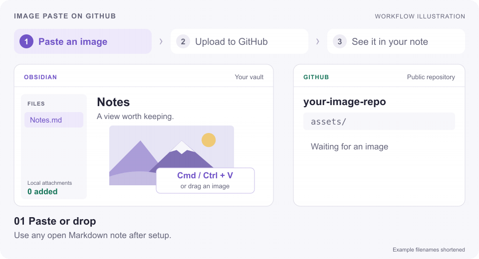

# Image Paste on GitHub

Upload pasted or dropped images to your public GitHub repository and embed their URLs in Obsidian.

**New in 1.2.0:** Connect with GitHub in your browser instead of creating and copying a PAT. OAuth tokens stay out of this plugin's `data.json`.


*Recorded in Obsidian.* [View the final frame](docs/images/obsidian-paste-demo.png).

> **Public uploads:** The repository must be public, and every uploaded image is publicly accessible. Do not upload sensitive screenshots.
>
> **Credentials:** Browser login uses Obsidian Secret storage when available, or memory for the current session on older versions. PATs remain unencrypted in plugin `data.json`; do not sync, commit, or share that file.

Install and enable Image Paste on GitHub from [Obsidian's community plugins](https://community.obsidian.md/plugins/image-paste-on-github).

## Quick start

1. Create a **public image repository**. Choose **GitHub App access → Choose repositories on GitHub** and install [Image Paste on GitHub](https://github.com/apps/image-paste-on-github) on **only that repository**, granting **Contents: read and write**.
2. Select **Connect with GitHub**, approve the browser login, then select **Return to Obsidian**. No PAT needs to be copied. If Obsidian opens another vault, return to the original vault and select **Complete sign in**.
3. Choose the **Image repository**, check **Branch** and **Upload path**, then paste or drop an image into a Markdown note. Selecting a repository fills in its default branch.

New installations of **1.2.0** use the plugin maintainer's [hosted authentication relay](https://image-paste-auth.dev-rudevico.workers.dev/health) by default; users do not need to deploy a server. It runs on **Cloudflare Workers Free and D1 Free**. Free-plan limits can temporarily interrupt sign-in or token renewal.

Existing PAT users keep their current authentication mode and token after upgrading. PAT entry is now under **Advanced settings**. Saved custom or empty relay addresses are also preserved. If an earlier source build saved an empty address, set **Authentication relay** to `https://image-paste-auth.dev-rudevico.workers.dev` to enable browser login.

<details>
<summary>Browser login, credentials, and disconnecting</summary>

The plugin uses GitHub App browser authorization with PKCE S256. The relay keeps the App client secret on the server, checks short-lived, single-use login transactions, and exchanges authorization codes and refresh tokens with GitHub. The browser-to-Obsidian link contains only random transaction and state values, never credentials or your vault name. **Images are uploaded directly to GitHub**, without passing through the relay.

Only use a relay you trust. It handles authorization codes, PKCE proof, and access and refresh tokens during exchange, renewal, and revocation. D1 temporarily stores pending-login metadata and authorization codes; access tokens, refresh tokens, and PKCE verifiers are never persisted on the relay. Logins expire after ten minutes, independently of delayed cleanup. D1's automatic Time Travel can retain prior database states for up to seven days on Free, so deleting a row does not immediately erase recovery copies. The plugin sends credentials only to the relay origin associated with that login. Disconnect and cancel any pending login before changing the relay. [Authentication design](docs/auth-design.md)

Access tokens renew automatically when needed, with one refresh request shared by concurrent uploads. The new access and refresh tokens are saved together. Expired authorization, an uncertain refresh result, or lost credentials requires reconnecting; the plugin never silently switches to your saved PAT.

On **Obsidian 1.11.4 or later**, browser credentials use Obsidian Secret storage rather than this plugin's `data.json`. Secret storage is accessible to other plugins; it is not isolation from untrusted plugins. On older supported Obsidian versions, browser credentials stay in memory and you must reconnect after restarting or reloading the plugin. Pending browser sign-in lasts ten minutes and is not restored after a restart.

**Disconnect** clears this device's stored browser credentials and attempts to revoke its access token. Network failures or an already expired token can prevent confirmation of remote revocation. Use **Advanced settings → Review GitHub authorizations** to revoke the App authorization on GitHub, or remove its repository installation. Disconnecting does not delete uploaded images or your saved PAT.

Install the App on a dedicated image repository. Contents write permission covers other files in that repository as well as images. The repository picker includes accessible public, unarchived repositories whose installation has Contents write and whose user permission reports push access.

</details>

<details>
<summary>Advanced: personal access token setup</summary>

1. Open **Advanced settings → Authentication method → Personal access token**.
2. Enter **Owner** and **Repository** for your public image repository.
3. Use **Create a token → Open GitHub**. Select only that repository, grant **Contents: read and write**, choose an **expiration date**, then enter the token in **GitHub token**.
4. Check **Branch**, then use **Test connection** and paste an image.

Your saved PAT is preserved when you try browser login. Switching to PAT disconnects browser credentials; switching back requires connecting and selecting a repository again. Owner, repository, branch, and upload path describe the currently selected upload destination, so check them when switching methods.

In PAT mode, **Create repository** tries to create a public repository with your token and opens GitHub if that fails. In browser-login mode, it opens GitHub; after creating the repository, grant the App access and refresh the repository list.

The screenshot below is a reference for repository selection and **Contents: read and write**; Metadata remains read-only. Set an expiration date for your own token, even though the screenshot shows “No expiration.”


PATs are stored unencrypted in this vault's plugin `data.json`, including an existing PAT retained after switching to browser login. Do not sync, commit, or share that file. If you stop using a PAT, clear it in Advanced settings and revoke it on GitHub. Revoke and replace any exposed token.

</details>

<details>
<summary>Repository, branch, and path settings</summary>

**Test connection** checks repository visibility and the reported push permission. It does not upload a test file, prove the token's Contents write permission, or check that the selected branch exists.

**Branch** defaults to `main`; select an existing branch. Browser repository selection fills in that repository's default branch. **Upload path** defaults to `assets`. Enter paths and branch names as-is, without URL encoding. Spaces, Unicode, `#`, `?`, parentheses, and literal `%` are encoded in URLs. Folder separators and branch names such as `feature/images` are supported.

</details>

<details>
<summary>Formats, failures, and cancellation</summary>

Successful uploads insert a `raw.githubusercontent.com` image link without creating a local attachment. While uploading, a temporary placeholder marks the insertion point.



*Workflow illustration.* [View the static diagram](docs/images/paste-workflow.svg).

Files with MIME types `image/png`, `image/jpeg`, `image/gif`, `image/webp`, `image/svg+xml`, `image/bmp`, and `image/avif` are uploaded without conversion. These types are selected from the file's MIME string, without inspecting its bytes.

**HEIC and HEIF** (`image/heic`, `image/heif`) are converted locally to JPEG with a bundled decoder. An empty MIME type is accepted only when the filename ends in `.heic` or `.heif`, ignoring case. Other unknown MIME types are not inferred from filenames. Conversion processes one primary image (or the first image) at JPEG quality 0.9, without preserving original metadata or additional images. HEIC conversions run one at a time and use no external conversion service.

With **Save locally on failure** enabled, an upload failure saves the image to your vault, including the converted JPEG for HEIC inputs. A conversion failure preserves the original HEIC or HEIF as a normal file link and shows a notice. With the setting off, conversion failure saves and uploads nothing. Export the original as JPEG and try again.

Missing configuration, mixed attachments such as an image and a PDF, unsupported files, Canvas, and editors outside an open Markdown note view use Obsidian's default handling. If one attachment is unsupported, the whole paste or drop uses the default handling.

Pending uploads stay tied to the original note when you switch tabs or rename it. Removing the placeholder cancels insertion and prevents uploads that have not started. A conversion already running may finish; an image already uploaded to GitHub is not deleted.

</details>

<details>
<summary>Development and license</summary>

Plugin development requires Node.js 20.19+, 22.13+, or 24+. Use Node.js 22.13+ or 24+ for relay development and the full test suite.

The relay uses Cloudflare Workers and D1 in production and local development. Atomic SQL batches share pending logins and prevent repeated code exchange; tests run in the actual local workerd runtime with a D1 database. Keep its account on Free: requests fail at its limits instead of switching to paid usage. See [Cloudflare setup](relay/cloudflare/README.md) and the [authentication design](docs/auth-design.md). The App client secret stays on the Worker, and images upload directly to GitHub.

For a self-hosted build, set `IMAGE_PASTE_AUTH_RELAY_URL` before building. An explicitly empty value disables the default relay. Tests cover the production bundle's default, overrides, and preservation of existing settings without contacting the hosted service.

```bash
npm ci
npm ci --prefix relay/cloudflare # Cloudflare development and testing tools
npm run dev           # watch build
npm run lint          # API compatibility and source checks used in plugin review
npm run build         # lint, type-check, and production bundle
npm test              # mocked plugin and API regression tests
npm run test:cloudflare # Workers API, D1, plugin-client integration, and configuration tests
npm run test:relay      # alias for test:cloudflare
npm run test:browser  # production-bundle settings UI and real HEIC conversion
```

Plugin tests cover PKCE, cancellation, credential storage, token rotation, and repository discovery. The Cloudflare suite checks atomic code consumption, expiry, uncertain commits, and SQL rollback in local workerd and D1. Its [client integration test](relay/cloudflare/test/auth-client.test.mjs) connects the plugin's `GitHubAuth` to that runtime for login, refresh, disconnect, cancellation, and denial. Automated GitHub requests are mocked, and no real credentials are needed.

The browser tests cover the settings UI and real HEIC conversion. The hosted relay has also been checked with a real App login, desktop callback, and sample upload in Obsidian 1.12.7 on macOS. Mobile callback return still needs live validation.

The browser tests use installed Google Chrome by default. Set `CHROME_EXECUTABLE_PATH` to another Chrome or Chromium executable if needed. The HEIC test uses the [synthetic fixture](tests/fixtures/SOURCE.txt). Browser tests block external requests and stub the GitHub API. No token is needed.

To override the hosted relay, build with `IMAGE_PASTE_AUTH_RELAY_URL=https://YOUR-AUTH-DOMAIN npm run build`. This value is a public origin, never a client secret. Keep server secrets in the relay deployment only.

For manual testing, copy `main.js`, `manifest.json`, and `styles.css` into `<vault>/.obsidian/plugins/image-paste-on-github/`.

The converter is pinned in `package.json` and `package-lock.json`. To replace it, update the dependency and lockfile, or the adapter in `src/heic.ts`, then run `npm ci` and `npm run build`. [Third-party notices](THIRD_PARTY_NOTICES) include pinned upstream source and decoder build instructions.

The plugin's own code is [MIT licensed](LICENSE). HEIC conversion bundles `heic-to` 1.6.7, `libheif` 1.23.7, and `libde265` 1.0.16 under LGPL version 3 or later. Their attribution, source links, and full license texts are in [THIRD_PARTY_NOTICES](THIRD_PARTY_NOTICES) and the generated `main.js`.

</details>
